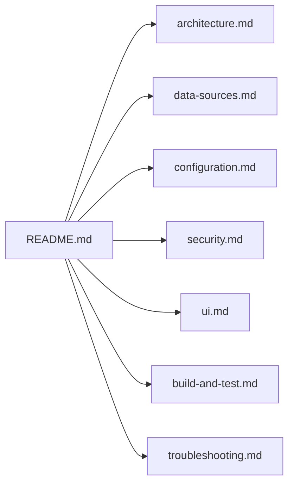

# Документация OpenCode Limits

Это справочник по устройству, источникам данных, настройкам и безопасности
меню-бар приложения **OpenCode Limits** (macOS 13+, SwiftPM, без внешних пакетов).

Быстрый старт — [корневой README](../README.md). Журнал архитектурных решений и
приёмки — [PLAN.md](../PLAN.md).

## Карта документации

| Документ | О чём |
| --- | --- |
| [Начальная страница](README.md) | Навигация, история изменений, с чего начать |
| [Архитектура](architecture.md) | Таргеты, слои, потоки данных, жизненный цикл |
| [Источники данных](data-sources.md) | Go usage API, локальный V2 API, SQLite-fallback |
| [Конфигурация](configuration.md) | UserDefaults, переменные окружения, ключи, прокси |
| [Безопасность](security.md) | Секреты, границы доверия, аудит, чек-лист |
| [Интерфейс](ui.md) | Меню-бар, попап, окно настроек, уведомления |
| [Сборка и тесты](build-and-test.md) | Makefile, dependency-free раннер, live smoke |
| [Диагностика](troubleshooting.md) | Типовые ошибки 401/403, прокси, пустая активность |

## С чего начать

- **Впервые в проекте:** [корневой README](../README.md) → [Архитектура](architecture.md) →
  [Источники данных](data-sources.md).
- **Нужно изменить поведение меню-бара или настроек:** [Интерфейс](ui.md) и
  [Конфигурация](configuration.md).
- **Нужно понять, откуда берутся числа:** [Источники данных](data-sources.md) —
  три источника, приоритет, агрегация и часовые пояса.
- **Перед коммитом или релизом:** [Безопасность](security.md) и
  [Сборка и тесты](build-and-test.md).
- **Что-то не работает:** [Диагностика](troubleshooting.md).

## История изменений

| Раунд | Что добавлено |
| --- | --- |
| 1 | Каркас проекта: SwiftPM-таргеты, SwiftUI-меню-бар, базовые модели Core |
| 2 | Раннер проверок без XCTest и периоды активности (7/30/90/«Всё время») |
| 3 | Выбор окна для иконки: 5 часов / Неделя / Месяц / Авто (максимум) |
| 4 | Активность из локального API OpenCode V2 с fallback на SQLite |
| 5 | Двойное кольцо иконки: внешнее — лимит, внутреннее — отсчёт 5-часового окна |
| 6 | Энергосбережение (батарейка / Low Power Mode) и контекстное меню правой кнопкой |
| 7 | новая компоновка окна настроек |
| 8 | `.gitignore`, аудит секретов, обновление корневого README |

Детали решений фиксируются в [PLAN.md](../PLAN.md), а описание форматов обмена —
в [Источниках данных](data-sources.md).
