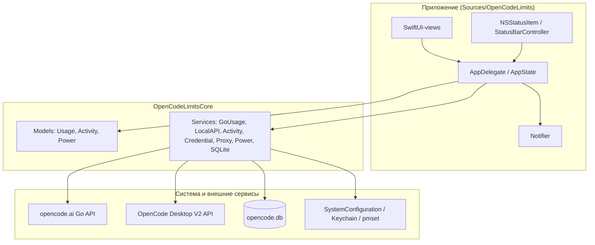

# Архитектура

Навигация: [документация](README.md) · [источники данных](data-sources.md) ·
[конфигурация](configuration.md) · [интерфейс](ui.md)

## Слои



## Таргеты SwiftPM

Проект использует `swift-tools-version: 5.9`, платформу macOS 13+ и **ноль**
удалённых зависимостей.

| Таргет | Тип | Зависимости | Назначение |
| --- | --- | --- | --- |
| `CSQLite3` | `.systemLibrary` | системный `libsqlite3` | `module.modulemap` + `shim.h` с `#include <sqlite3.h>` (заголовок есть только в sysroot SDK) |
| `OpenCodeLimitsCore` | library | `CSQLite3` | Публичные модели и сервисы; независим от SwiftUI |
| `OpenCodeLimits` | executable | `OpenCodeLimitsCore` | Меню-бар, настройки, уведомления |
| `OpenCodeLimitsTests` | executable | `OpenCodeLimitsCore` | Раннер проверок **без XCTest** |

`XCTest.framework` / `XCTest.swiftmodule` в установленных CommandLineTools
отсутствуют, поэтому тесты оформлены как обычный исполняемый таргет с
собственными `check`/`equal` и ненулевым кодом выхода при провале. По этой же
причине UI избегает макросов SwiftUI (`@State`, `#Preview`): плагин
`SwiftUIMacros` поставляется только с полным Xcode.

## Потоки данных

```mermaid
flowchart LR
    GO[GET /inference/go/v1/usage] --> GUS[GoUsageService]
    GUS --> US[UsageSnapshot]
    US --> ST[AppState]
    STATS[/api/experimental/session/stats] --> LAS[LocalAPIService]
    SESS[/api/session] --> LAS
    LAS --> AS[ActivitySnapshot source = api]
    SQL[(session_message)] --> ASV[ActivityService]
    ASV --> DB[ActivitySnapshot source = database]
    AS --> ST
    DB --> ST
    PM[PowerMonitor / pmset] --> ST
    ST --> UI[Views + NSStatusItem]
    ST --> N[Notifier]
```

**Лимиты.** `GoUsageService` читает ключ через `CredentialStore`, выполняет
запрос с прокси из `ProxyProvider` и возвращает `UsageSnapshot` (три окна
`rolling` / `weekly` / `monthly`). `AppState` выбирает через
`UsageSnapshot.meter(for:)` (`TrayMeter`) окно, чья цифра процента выводится в
иконке. Единственное кольцо иконки — зелёный отсчёт до сброса 5-часового лимита;
оно всегда строится из `rolling` через `UsageMeter.rollingWindowFraction(now:)`.

**Активность.** `ActivityService.load(days:)` сначала вызывает
`LocalAPIService.fetch` (API-first). При любом сбое — отсутствующий CLI, нет
пароля, не-200, таймаут, ошибка разбора — исключение гасится и выполняется
существующий SQLite-путь. Источник фиксируется в `ActivitySnapshot.source`
(`api` или `database`).

**Питание.** `PowerMonitor` (кэш 60 с) определяет `PowerState`, `AppState`
пересчитывает интервалы через `AppConfig.effectivePollInterval` и планирует
таймеры.

## Ключевые решения

- **SwiftUI для попапа и настроек.** Декларативные views просто связываются с
  `ObservableObject` (`AppState`, `Settings`); окно настроек открывается через
  `NSHostingController` (совместимо с macOS 13 без `@Environment(\.openSettings)`).
- **Core — отдельная библиотека.** Вся работа с сетью, БД, Keychain и
  SystemConfiguration собрана в `OpenCodeLimitsCore`, независима от UI и
  тестируется отдельно; executable-таргет остаётся тонким слоем.
- **API-first с fallback на SQLite.** Локальный V2 API даёт точные суммы
  (`stats.steps`, `stats.tokens`, `stats.cost`), а база — запасной источник без
  сетевых зависимостей. Переключение прозрачно для пользователя, источник
  виден в интерфейсе.
- **Никаких XCTest и SwiftUI-макросов.** Ограничение CommandLineTools (см. выше).
- **`NSStatusItem`, а не `MenuBarExtra`.** Позволяет различать левый и правый
  клики по иконке (контекстное меню) и полностью контролировать отрисовку двух
  колец (`TrayIcon`).

## Жизненный цикл

Вход в приложение — **чистый AppKit**, без SwiftUI `App`/Scene: `@main enum Main`
создаёт `NSApplication.shared`, назначает `AppDelegate`, явно вызывает
`bootstrap()` и запускает `app.run()`. Это важно по двум причинам:

1. После замены `MenuBarExtra` на `NSStatusItem` единственной Scene оставалась
   `SwiftUI.Settings`, и SwiftUI **сам открывал окно настроек при первом запуске**.
   Все views здесь хостятся вручную (`NSPopover`, `NSHostingController`), поэтому
   Scene не нужна вовсе.
2. При `@main` на самом `NSApplicationDelegate` метод `applicationDidFinishLaunching`
   не приходит надёжно, поэтому инициализация вынесена в явный `bootstrap()`.

Без переменной `OPENCODE_SHOW_SETTINGS_ON_LAUNCH` приложение стартует **без единого
окна** — только иконка в строке меню.

`AppDelegate` создаёт **один** `AppState` на всё время работы приложения и
передаёт его во views и `StatusBarController`. В `AppState` работают три таймера:

| Таймер | Интервал по умолчанию | В энергосбережении | Действие |
| --- | --- | --- | --- |
| Опрос лимитов | `defaultPollInterval` = 60 с | `max(base, batteryPollInterval)` = 300 с | Сетевой `refresh()` |
| Перерисовка иконки | `normalClockInterval` = 30 с | `energySavingClockInterval` = 60 с | Только обновление `clock` и опрос состояния питания; без сети |
| Активность | `normalActivityInterval` = 300 с | `energySavingActivityInterval` = 900 с | Перезагрузка активности, если данные устарели |

Изменения настроек и состояния питания через Combine пересобирают таймеры.
При уходе в сон `suspendForSleep()` инвалидирует таймеры и отменяет текущий
запрос; при пробуждении `resumeFromWake()` обновляет `PowerState`, перепланирует
таймеры и делает немедленный `refresh(requestActivity: true)`.

Приложение объявлено как `LSUIElement`: нет иконки в Dock, нет обычного окна
при запуске. Переменная `OPENCODE_SHOW_SETTINGS_ON_LAUNCH=1` открывает настройки
сразу при старте (режим отладки).

## Карта файлов

| Путь | Роль |
| --- | --- |
| `Sources/CSQLite3/module.modulemap`, `shim.h` | Системный модуль SQLite |
| `Sources/OpenCodeLimitsCore/Models/Usage.swift` | `UsageMeter`, `UsageSnapshot`, `TrayMeter`, константы `AppConfig`/`AppDefaultsKey` |
| `Sources/OpenCodeLimitsCore/Models/Activity.swift` | `ActivitySnapshot`, метрики, `ActivitySource` |
| `Sources/OpenCodeLimitsCore/Models/Power.swift` | `PowerState`, разбор вывода `pmset` |
| `Sources/OpenCodeLimitsCore/Services/SQLite.swift` | Обёртка `sqlite3_open_v2(..., SQLITE_OPEN_READONLY, ...)` |
| `Sources/OpenCodeLimitsCore/Services/CredentialStore.swift` | Три источника ключа Go API |
| `Sources/OpenCodeLimitsCore/Services/ProxyProvider.swift` | Прокси из SystemConfiguration / `HTTPS_PROXY` |
| `Sources/OpenCodeLimitsCore/Services/GoUsageService.swift` | Запрос лимитов Go |
| `Sources/OpenCodeLimitsCore/Services/ActivityService.swift` | Агрегация, fallback на БД |
| `Sources/OpenCodeLimitsCore/Services/LocalAPIService.swift` | Локальный V2 API (обнаружение, Basic auth, разбор) |
| `Sources/OpenCodeLimitsCore/Services/PowerMonitor.swift` | LPM + `pmset -g batt`, кэш 60 с |
| `Sources/OpenCodeLimits/App/{AppState,Settings,Notifier,StatusBarController}.swift` | Состояние, настройки, уведомления, иконка |
| `Sources/OpenCodeLimits/Views/{MenuBarView,UsageMeterView,ActivityView,SettingsView,TrayIcon}.swift` | UI |
| `Sources/OpenCodeLimits/OpenCodeLimitsApp.swift` | Точка входа: `@main enum Main` (чистый AppKit: `NSApplication.shared.run()`), `AppDelegate.bootstrap()` и сильное удержание delegate. Файл **не** называется `main.swift`: SwiftPM трактует такое имя как модуль с top-level code и запрещает в нём `@main` |
| `Tests/OpenCodeLimitsTests/{UsageDecodingTests,ActivityAggregationTests,LocalAPITests,PowerTests}.swift` | Раннер проверок |

См. также: [Источники данных](data-sources.md), [Конфигурация](configuration.md),
[Безопасность](security.md), [Сборка и тесты](build-and-test.md).
