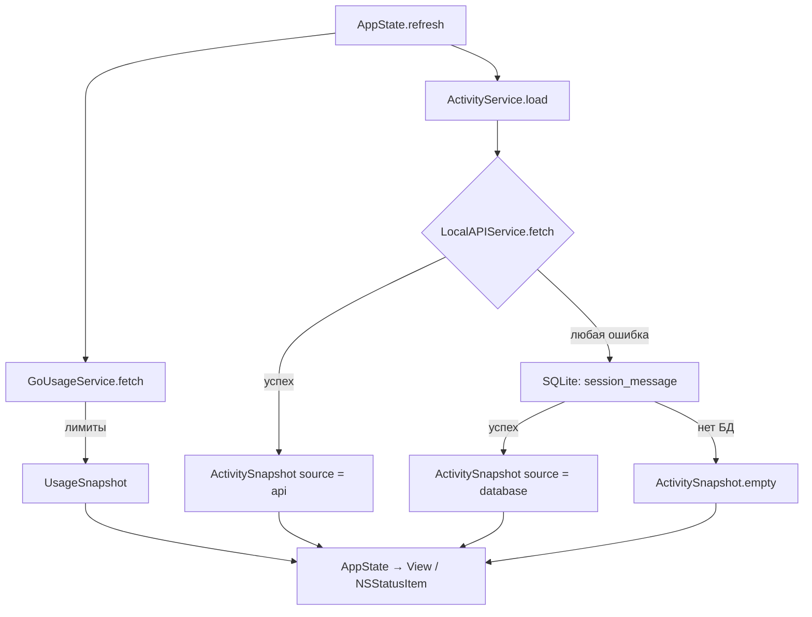

# Источники данных

Навигация: [документация](README.md) · [архитектура](architecture.md) ·
[конфигурация](configuration.md) · [диагностика](troubleshooting.md)

Приложение использует три независимых источника: Go usage API (лимиты подписки),
локальный V2 API OpenCode Desktop (активность, предпочтительный источник) и
локальную SQLite-базу OpenCode (резервный источник активности).



## 1. Go usage API — лимиты

```
GET https://opencode.ai/inference/go/v1/usage
Authorization: Bearer oc_sk_…
User-Agent: opencode-limits-monitor/0.1
```

Ключ получается через `CredentialStore` **при каждом опросе** (см.
[Конфигурацию](configuration.md)). Запрос идёт через прокси из `ProxyProvider`,
причём конфигурация перечитывается на каждый опрос — смена прокси не требует
перезапуска приложения.

Пример ответа (значения условные):

```json
{
  "usage": {
    "rolling": {"status": "ok", "percent": 8, "resetsAt": "2026-11-23T11:18:05.000Z"},
    "weekly":  {"status": "ok", "percent": 3, "resetsAt": "2026-11-30T00:00:00.000Z"},
    "monthly": {"status": "ok", "percent": 49, "resetsAt": "2026-12-16T18:47:26.000Z"}
  }
}
```

| Поле | Тип | Значение |
| --- | --- | --- |
| `status` | string | `ok` или `rate-limited` (лимит исчерпан); неизвестное значение → `.unknown` |
| `percent` | number | 0...100, обрезается при разборе |
| `resetsAt` | string | ISO8601 с дробными секундами и `Z`; разбор с fallback без дробей |

Семантика окон:

| Окно | Доля месячного лимита | Когда сбрасывается |
| --- | --- | --- |
| `rolling` | 20 % | Через 5 часов после **первого использования** окна; до начала окна сервер возвращает `resetsAt = now + 5h` |
| `weekly` | 50 % | Каждый понедельник 00:00 UTC |
| `monthly` | 100 % | В начале оплаченного периода |

`UsageMeter.rollingWindowFraction(now:)` возвращает
`clamp((resetsAt - now) / 5h, 0...1)` — кольцо иконки в трее: 1 = полные 5 часов
впереди, 0 = сброс сейчас. Без `resetsAt` результат `nil`.

Ошибки:

| HTTP | Обработка |
| --- | --- |
| 401 | `UsageError.invalidKey` — ключ недействителен |
| 403 | `UsageError.noSubscription(message)` — в теле `EntitlementError`, подписки нет |
| прочий не-2xx | `UsageError.network` |
| неверный JSON | `UsageError.decoding` |
| нет ключа | `UsageError.missingKey` из `CredentialStore` |

**Что не используется.** Поле `opencode.allowance` в ответах inference — это
стоимость в долларах, начисленная за конкретный запрос; ретроспективно его
получить нельзя. Публичный Console API (`/console/api/v1/...`) не содержит
endpoint истории: проверено около 30 путей, все дают 404; работает только
`/console/api/v1/models`. Поэтому лимиты берутся напрямую из Go API, а не из
истории запросов. Отдельно отметим: `/api/experimental/usage/limits` локального сервиса на
этой машине возвращает `data: null` и **не применяется**.

## 2. Локальный V2 API OpenCode Desktop — активность

Сервис OpenCode Desktop 2.3.0 слушает localhost. Адрес обнаруживается так:

```bash
opencode-cli service status        # → http://127.0.0.1:<port>
```

`LocalAPIService` ищет исполняемый файл по glob
`~/Library/Application Support/ai.opencode.desktop/cli/*/opencode-cli`
(берётся последний по сортировке путь), запускает `service status` с таймаутом
3 с и извлекает первый адрес вида `http://127.0.0.1:<port>`. Адрес кэшируется
в памяти и переопределяется при ошибке запроса (CLI мог перезапуститься на
другом порту).

**Аутентификация.** Пароль лежит в `~/.config/opencode/service.json` в поле
`password` (переопределяется `OPENCODE_SERVICE_CONFIG`). Заголовок:

```
Authorization: Basic base64("opencode:" + <password>)
```

Префикс `opencode:` обязателен: `base64(":" + <password>)` и
`base64(<password>)` возвращают 401. Значение заголовка никуда не выводится.

### Статистика

```
GET /api/experimental/session/stats?from=<ms>&to=<ms>&tools=none&timezone=<tz>
```

`from` и `to` — миллисекунды epoch строками. Ответ (сокращённо, значения
условные):

```json
{
  "data": {
    "range": {"from": 1764000000000, "to": 1764086400000},
    "sessions": 12, "subagents": 0, "prompts": 40, "steps": 6,
    "tokens": {"input": 1000, "output": 200, "reasoning": 10,
               "cache": {"read": 50, "write": 5}},
    "cost": 0.0,
    "activeDays": 2, "streak": 1,
    "activity": [{"date": "2026-11-22", "steps": 2}, {"date": "2026-11-23", "steps": 4}],
    "models": [
      {"model": {"id": "big-pickle", "providerID": "opencode", "variant": "default"},
       "steps": 4, "tokens": {...}, "cost": 0.0}
    ]
  }
}
```

| Поле | Назначение в приложении |
| --- | --- |
| `tokens.{input,output,reasoning,cache.read,cache.write}` | Итог `totalTokens` (включая кэш) |
| `cost` | Итог `totalCost` (на бесплатных моделях 0) |
| `steps` | Итог `totalMessages` |
| `activity[].date` / `.steps` | Число сообщений в дневных и месячных корзинах |
| `models[].tokens` / `.cost` / `.steps` | Корзины моделей, сортировка по токенам |
| `range`, `sessions`, `prompts`, `tools`, `activeDays`, `streak` | Присутствуют в ответе, в расчётах не участвуют |

Обратите внимание на обёртку `{"data": ...}`: разбирается именно `data`, а не
корень ответа.

### Сессии

```
GET /api/session
```

```json
{
  "data": [
    {"id": "ses_…", "projectID": "prj_…", "title": "Сессия",
     "model": {"id": "big-pickle", "providerID": "opencode", "variant": "default"},
     "cost": 0.0, "tokens": {...}, "outcome": "…",
     "time": {"created": 1764000000000, "updated": 1764000123000}}
  ]
}
```

Из каждой записи строится синтетическое `UsageEvent`: `time.created` (мс →
`Date`), `tokens`, `cost`, `model.id` / `model.providerID`, `title`, `projectID`.
Эти события подаются в `ActivityService.aggregate(events:days:now:source: .api)`,
чтобы получить `daily`, `monthly`, `sessions` и базовые суммы. Затем значения
`totalTokens`, `totalCost`, `totalMessages` и `models` **перезаписываются**
более точными данными из `stats`. `hourly` для API-источника может быть пустым
(UI его не использует).

Даты `activity[].date` — локальные календарные дни (`yyyy-MM-dd`,
`en_US_POSIX`, `Calendar.current`), они приводятся к `startOfDay` и сопоставляются
с корзинами. Временны́е метки `from`/`to` и `time.created` — миллисекунды epoch.

**Сеть.** Запросы к localhost идут без системного прокси
(`connectionProxyDictionary = [:]`), таймаут запроса 5 с. Для `opencode.ai`
используется отдельный `ProxyProvider` (см. [Конфигурацию](configuration.md)).

## 3. SQLite — резервный источник активности

Путь по умолчанию: `~/.local/share/opencode/opencode.db` (переопределяется
`OPENCODE_DB_PATH`). База открывается **только для чтения**:
`sqlite3_open_v2(path, … SQLITE_OPEN_READONLY, nil)` — WAL-файл не изменяется.

Один параметризованный запрос:

```sql
SELECT sm.id, sm.session_id, sm.time_created,
       json_extract(sm.data, '$.tokens.input'),
       json_extract(sm.data, '$.tokens.output'),
       json_extract(sm.data, '$.tokens.reasoning'),
       json_extract(sm.data, '$.tokens.cache.read'),
       json_extract(sm.data, '$.tokens.cache.write'),
       COALESCE(json_extract(sm.data, '$.cost'), 0),
       json_extract(sm.data, '$.model.providerID'),
       json_extract(sm.data, '$.model.id'),
       COALESCE(sv2.title, ''), COALESCE(p.name, '')
FROM session_message AS sm
LEFT JOIN session_v2 AS sv2 ON sv2.id = sm.session_id
LEFT JOIN project AS p ON p.id = sv2.project_id
WHERE sm.type = 'assistant' AND sm.time_created >= ?
ORDER BY sm.time_created ASC;
```

Правила, которые нельзя нарушать:

- **Никогда не читать `data.content`** — это приватные промпты пользователя.
- **Никогда не читать таблицу `part`** (`type = 'step-finish'`): она дублирует
  `session_message` (обнаружено 2236 пересекающихся строк), суммы удвоились бы.
- `time_created` — миллисекунды epoch; `daily` ограничивается 90 корзинами,
  `monthly` — не ограничивается; суммы, модели, сессии и `hourly` строятся по
  всем загруженным событиям.

Если файла нет или событий нет — возвращается `ActivitySnapshot.empty`.
Реальные ошибки SQL дают `UsageError.database`.

Источник результата фиксируется в `ActivitySnapshot.source`: `api` или
`database` (заголовки «API OpenCode» / «Локальная БД»).
