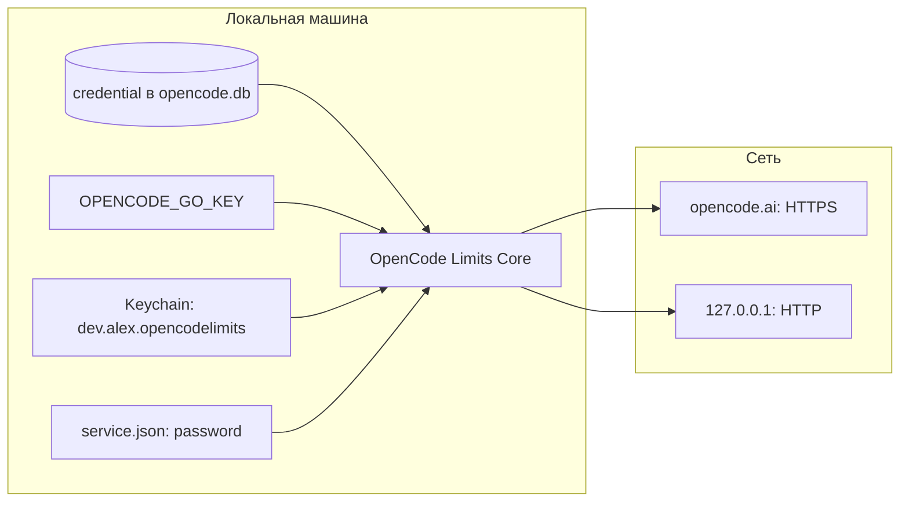

# Безопасность

Навигация: [документация](README.md) · [архитектура](architecture.md) ·
[источники данных](data-sources.md) · [конфигурация](configuration.md)

Приложение работает с двумя категориями конфиденциальных данных: ключом Go API
и паролем локального сервиса OpenCode. Оба хранятся **вне репозитория** и никогда
не выводятся в журнал.

## Границы доверия

Единственные сетевые адреса:

- `https://opencode.ai/inference/go/v1/usage` — лимиты подписки, `Bearer oc_sk_…`;
- `http://127.0.0.1:<port>` — локальный V2 API, `Basic base64("opencode:" + <password>)`.

Никаких других исходящих запросов (включая телеметрию) приложение не делает.

## Где живут секреты

| Секрет | Место | В репозитории |
| --- | --- | --- |
| Ключ Go API (`oc_sk_…`) | `credential` в `~/.local/share/opencode/opencode.db`, `OPENCODE_GO_KEY` или Keychain | Никогда |
| Пароль локального сервиса | `~/.config/opencode/service.json`, поле `password` (переопределяется `OPENCODE_SERVICE_CONFIG`) | Никогда |
| Basic-заголовок | Собирается в памяти по формуле `base64("opencode:" + <password>)` | Никогда |

`CredentialStore` перечитывает ключ при каждом опросе и не кэширует его в
памяти дольше одного запроса. В `UserDefaults` сохраняется только имя выбранного
источника (`opencode.db` / `Keychain` / `OPENCODE_GO_KEY`).

## Что никогда не читается и не логируется

- `data.content` из `session_message` — приватные промпты пользователя;
- таблица `part` (`step-finish`) — дублирует `session_message` (2236
  пересекающихся строк) и привела бы к двойному счёту;
- значение ключа и пароля, заголовки `Authorization`, а также сами base64-строки;
  сообщения об ошибках содержат только код/тип ошибки и описание без секретов;
- содержимое `service.json`, `auth.json`, `*.db`, `.env*` — в репозиторий не
  копируется.

База OpenCode открывается **только для чтения**
(`sqlite3_open_v2(..., SQLITE_OPEN_READONLY, nil)`): приложение не может
изменить данные даже при ошибке.

## Игнорируемые файлы

`.gitignore` закрывает: `.build/`, `build/`, `.swiftpm/`, `DerivedData/`,
`*.app/`, `*.log`, `.env*`, `.DS_Store`, временные файлы редакторов. Это
исключает случайный коммит артефактов сборки и локальных конфигураций.

## Результаты аудита

По состоянию на последнюю проверку:

- репозиторий: **0 коммитов, 0 отслеживаемых файлов, без remote**;
- сканирование нашло **0 настоящих ключей** `oc_sk_` — только короткие шаблоны
  из документации и тестов;
- не найдено base64-значений пароля, копий `service.json`, `auth.json`, `*.db`
  или `.env*`.

Аудит нужно повторять перед каждым коммитом, который добавляет новые файлы.

## Чек-лист перед коммитом

1. Ни одного `oc_sk_…` с реальным значением — только плейсхолдеры.
2. Ни одного пароля, базового заголовка или токена в коде, тестах и docs.
3. Нет копий `service.json`, `auth.json`, баз данных и `.env*`.
4. Новая диагностика не печатает `Authorization` и не логирует ответы с ключом.
5. Работа с БД остаётся read-only, запросы не трогают `content` и `part`.
6. Новые файлы не попадают под исключения `.gitignore` случайно (проверка
   `git status` и `git check-ignore -v <файл>`).
7. Сборка и раннер проверок проходят (`make test`, `make smoke`).

## Если ключ утёк

1. **Отзовите ключ** в консоли OpenCode (Console → ключи/интеграции) и создайте
   новый; именно отзыв, а не удаление файла, останавливает использование.
2. Удалите ключ из Keychain (`dev.alex.opencodelimits` / `go-api-key`) и из
   `OPENCODE_GO_KEY`, если он был там продублирован.
3. Проверьте `credential` в `opencode.db` и при необходимости деактивируйте
   старую запись (`active = 0`) штатными средствами OpenCode.
4. Убедитесь, что секрет попал в историю git. Если коммит уже опубликован,
   ключ считается скомпрометированным независимо от последующего удаления файла;
   требуется ротация, а не просто `git rm`.
5. Обновите документацию и тесты так, чтобы в них остались только плейсхолдеры
   `oc_sk_…` и `<password>`.

См. также: [Конфигурацию](configuration.md) и [Диагностику](troubleshooting.md).
